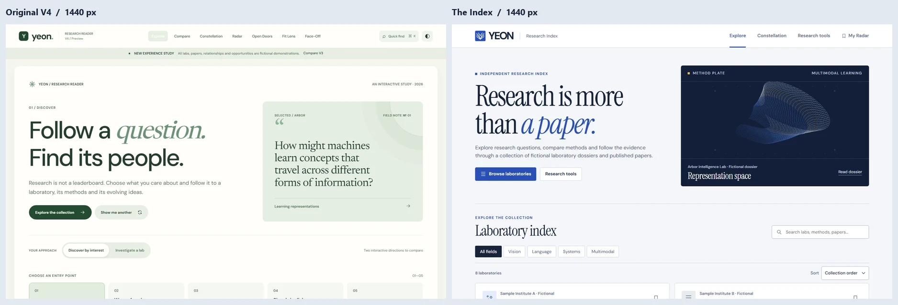
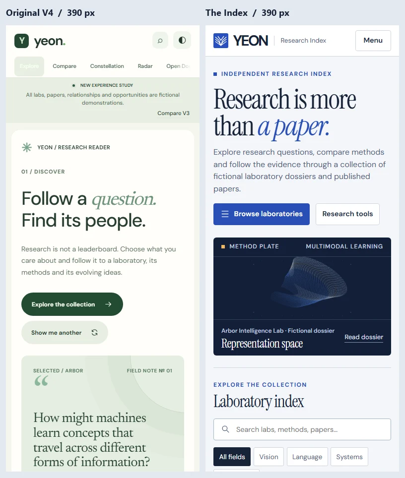

# YEON Index review

## Visual review

Both comparisons show the first 900 CSS pixels at the same viewport width. The desktop comparison is scaled equally on each side.





Inspection led to three changes: the full wire illustration fits its plate, the mobile search box occupies the available width, and choosing a node in the alternative graph list brings its inspector into focus. Font preloads and a reserved initial page height removed the layout shift observed in the first mobile Lighthouse run.

## Functional and accessibility checks

Local Chromium 141, Playwright 1.56.1 and axe-core 4.14.1 ran against the built frontend over HTTP. The browser script starts and closes its own server.

- Twelve routes at 1440, 1280, 1024, 768, 430, 390, 360 and 320 px. All 96 route/width checks passed without horizontal document overflow.
- All four cross-feature journeys passed, including the back button restoring a filtered search, paper-to-lab graph navigation, method selection, saved Fit Lens interests, and Radar persistence after reload.
- Graph filtering, pointer pan, zoom, reset, keyboard list selection, collapsed mobile navigation, reduced motion, invalid records, empty searches, unknown and expired availability, and missing source checks were exercised.
- No uncaught page errors. Axe returned zero violations across 24 route/viewport combinations using WCAG A/AA tags through 2.2. The first pass identified graph nodes whose accessible names differed from their visible text. The revised nodes use their rendered labels.
- The original V4 browser smoke passed at its six viewport widths, including keyboard selection, mobile search, theme and reading mode. The existing frontend static checks also passed.
- Screen-reader speech output, Safari, Firefox, physical devices and production traffic were not tested. Automated checks alone cannot establish WCAG conformance.

To reproduce in a disposable checkout with Node 22 or later:

```sh
npm install --no-save --no-audit --no-fund playwright@1.56.1 axe-core@4.14.1
npx playwright install chromium
node tests/index-reader.mjs
node tests/v4-original-browser-smoke.mjs
```

Screenshots and the machine-readable route and accessibility summary are written under `artifacts/index-reader/`. The PR workflow uploads that directory for review.

## Performance

One local Lighthouse 12.8.2 navigation per profile against a cold, uncompressed Python HTTP server. These values describe Explore on this machine.

| Profile | Performance | Accessibility | FCP | LCP | CLS | Total blocking time | Transfer |
| --- | ---: | ---: | ---: | ---: | ---: | ---: | ---: |
| Mobile simulation | 95 | 100 | 1.5 s | 2.8 s | 0 | 0 ms | 277 KiB |
| Desktop preset | 100 | 100 | 0.3 s | 0.6 s | 0 | 0 ms | 277 KiB |

In 30 alternating local updates at 1280 px, the 95th-percentile synchronous search update including layout took 5.9 ms. A graph zoom update including layout took 1.6 ms. The sample has eight dossiers. These observations do not predict large-catalogue performance or end-user network latency.

## Data and operations

There are no verified lab or opportunity records. Eight fictional lab fixtures, one explicitly fictional notice and four independent published papers are available for exploration. Matching and saved choices run on the device. A public application link can be displayed when a sourced opportunity is added. The preview uses no backend, analytics, authentication, remote fonts or paid services.
